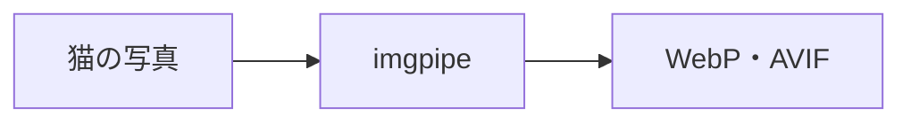
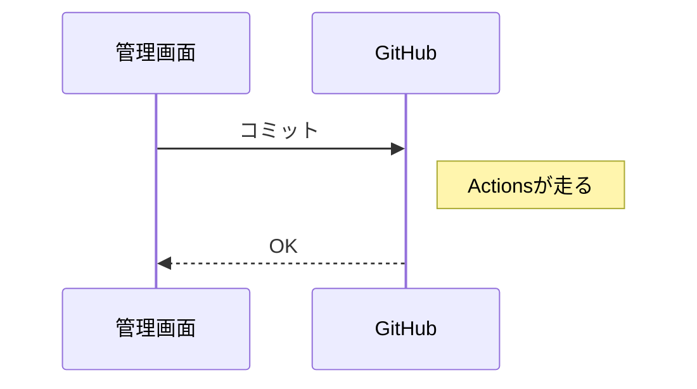

本文で使える記法の見本です。イベントの本文などで、このとおりに書けます。

## 見出し

`##`の見出しには、自動でアンカーがつきます。

### 小見出し

段落は空行で分けます。**太字**、*斜体*、~~打ち消し~~、`コード`、[リンク](/stack/)が使えます。

## リスト

- 黒猫
- キジ
  - キジ白
- 三毛

1. 写真を撮る
2. 位置情報を消す
3. 載せる

- [x] 証明する
- [ ] 昼寝する

## 表

| 猫   | 毛色 | 好きなもの |
| ---- | ---- | ---------- |
| 雷   | 黒   | 畳         |
| きなこ | キジ白 | 段ボール   |

## 引用

> 吾輩は猫である。名前はまだ無い。

## アラート

> [!NOTE]
> 猫は液体です。容器に合わせて形が変わります。

> [!TIP]
> 段ボールを置いておくと、だいたい入ります。

> [!IMPORTANT]
> ごはんの時間は守ります。

> [!WARNING]
> しっぽを踏まないこと。

> [!CAUTION]
> 掃除機をかけると逃げます。

## コード

```rust
pub fn outline(frame: &Frame) -> Outline {
    // 輪郭は必ず閉じる(Leanで証明済み)
    let width = frame.width + 2;
    todo!()
}
```

```lean4
theorem outline_closed (n : frames.FrameName) :
    (do let f ← frames.frame n; outline.outline f) ⦃ o =>
      Closed (outlineAt o) o.width.val o.height.val ⦄ := by
  apply WP.spec_bind (frames.frame.spec' n)
  -- …
```

```tla
NoDoubleOpen == opening <= 1 \* 幕が二重に開かない
```

## 数式

文中の数式は $x + 2$ のように書きます。

$$
\forall c \in \mathrm{Cats},\ \mathrm{closed}(\mathrm{outline}(c))
$$

## リンクカード

https://simpleicons.org/

## 図




